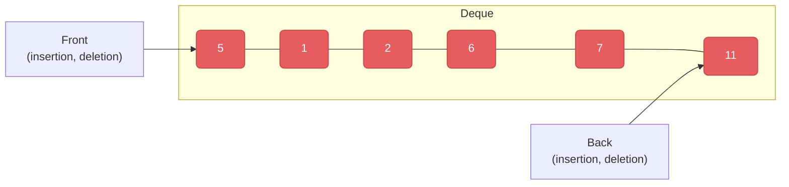
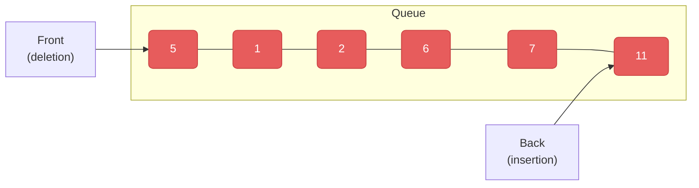

## 📘 `deque` & `queue` 정리

### 📌 개요

- **deque**(double-ended queue): 양쪽 끝에서 **삽입/삭제** 가 가능한 **동적 배열 컨테이너**  
- **queue**: 한쪽에서 넣고 다른 쪽에서 꺼내는 **FIFO** 구조의 **컨테이너 어댑터** (기본 구현은 `deque`)


### 📌 deque 한눈에 보기



- `push_front`, `push_back`, `pop_front`, `pop_back` 등 **양끝 조작** 지원
- 중간 위치의 `insert/erase`도 가능 (성능은 컨테이너 특성에 의존)

#### 🔹 내부 메모리 모델


- 여러 **고정 크기 블록** 을 연결해 관리 → `vector`와 달리 확장 시 전체 복사가 감소
- 그 결과, **앞쪽 연산도 효율적** 이며 확장 시 재할당 비용이 낮음

#### 🔹 간단 예제
```cpp
#include <iostream>
#include <deque>

int main() {
    std::deque<int> dq = {1, 2, 3, 4, 5};

    dq.pop_front();
    for (auto& n : dq) std::cout << n << " ";
    std::cout << "\n";   // 2 3 4 5

    dq.push_back(11);
    for (auto& n : dq) std::cout << n << " ";
    std::cout << "\n";   // 2 3 4 5 11
}
```

#### 🔹 생성/연산 요약
- 생성자: `deque<T>()`, `deque<T>(n)`, `deque<T>(n, value)`, 복사/이동 생성 등
- 비교 연산자: `==`, `!=`, `<`, `>`, `<=`, `>=`
- 주요 멤버:
  - 접근: `at(i)`, `operator[]`, `front()`, `back()`
  - 수정: `push_front()`, `push_back()`, `pop_front()`, `pop_back()`, `insert`, `erase`, `clear()`
  - 크기: `size()`, `resize(n[, value])`
  - 반복자: `begin()`, `end()`, `rbegin()`, `rend()`
  - 기타: `swap()`, `assign()`  
- **주의**: `deque`에는 `capacity()`가 없습니다.

#### 🔹 반복자 & 무효화
- 앞/뒤 삽입·삭제 시, 해당 위치와 **이후 일부 반복자가 무효화** 될 수 있음
- `insert/erase` 후에는 반환되는 반복자를 사용해 갱신할 것

---

### 📌 queue 한눈에 보기



- **FIFO(First-In, First-Out)**  
- 내부적으로 `deque`(기본) 또는 `list`/`vector` 등으로 구성 가능한 **컨테이너 어댑터**

#### 🔹 기본 사용
```cpp
#include <iostream>
#include <queue>
int main() {
    std::queue<int> que;
    for (int i = 0; i < 5; ++i) que.push(i);

    int output = que.front();
    que.pop(); // 꺼낸 요소: output

    while (!que.empty()) {
        std::cout << que.front() << " ";
        que.pop();
    }
}
```

### 📌 멤버 함수 표
| 함수 | 설명 |
|---|---|
| `empty()` | 비어 있으면 `true` |
| `size()` | 원소 수 반환 |
| `front()` | 맨 앞 원소 참조 |
| `back()` | 맨 뒤 원소 참조 |
| `push(x)` | 맨 뒤에 원소 추가 |
| `pop()` | 맨 앞 원소 제거 |


### 📌 deque vs vector (요점 정리)
- **양끝 조작**: `deque`는 앞·뒤 모두 효율적 / `vector`는 **뒤쪽** 이 효율적
- **메모리 모델**: `deque`는 **블록 기반**, `vector`는 **연속 메모리**
- **랜덤 접근**: 둘 다 `O(1)` (하지만 `deque`는 블록 인덱싱 비용이 약간 더 큼)
- **capacity**: `vector`는 `capacity()` 제공 / `deque`는 없음


### 📌 요약
- `deque`: 양쪽 끝에 강한 동적 배열, 블록 기반이라 확장 비용이 낮음
- `queue`: FIFO 어댑터, 기본 구현 컨테이너는 `deque`
- 상황에 맞게 `vector`/`deque`/`queue`를 선택하고, **반복자 무효화** 를 항상 고려

---

## 📘 std::deque — CAD/CAE 확산 탐색 중심

- `std::deque<T>`는 **양쪽 끝에서 원소를 효율적으로 추가·삭제** 할 수 있는 C++ 표준 시퀀스 컨테이너.
- 이름은 **double-ended queue** 에서 왔으며, `std::vector`처럼 `operator[]`로 임의 접근도 가능합니다.
- CAD/CAE에서는 **인접 요소로 전파되는 탐색(frontier)**, BFS, 연결 요소 찾기, 경계에서 내부로의 단계별 확산 등에 적합합니다.
- 여기서 '확산'은 **인접 관계를 따라 방문 대상을 넓히는 알고리즘** 을 의미합니다. 물리적인 열·물질 확산 PDE의 수치해법을 `deque`가 직접 구현하는 것은 아닙니다.

### 📌 정의 및 기본 사용

```cpp
#include <deque>

std::deque<int> q;
q.push_back(10);   // 뒤에 추가
q.push_back(20);
q.push_front(5);   // 앞에 추가

int first = q.front(); // 5
int last  = q.back();  // 20
int item  = q[1];      // 10

q.pop_front();         // 앞 원소 제거 (반환값 없음)
q.pop_back();          // 뒤 원소 제거 (반환값 없음)
```

> `pop_front()`와 `pop_back()`은 값을 반환하지 않습니다.
> 필요한 값은 제거 전에 `front()` 또는 `back()`으로 읽습니다.
> 빈 컨테이너에서 `front()`, `back()`, `pop_front()`, `pop_back()`을 호출하면 안 됩니다.

### 📌 주요 함수

| 함수 | 역할 | 일반적인 시간 복잡도 |
|------|------|----------------------|
| `push_back(x)` / `emplace_back(...)` | 뒤에 삽입 | O(1) (상수 시간) |
| `push_front(x)` / `emplace_front(...)` | 앞에 삽입 | O(1) (상수 시간) |
| `pop_back()` / `pop_front()` | 끝 원소 제거 | O(1) |
| `front()` / `back()` | 양 끝 원소 참조 | O(1) |
| `operator[](i)` / `at(i)` | 인덱스로 접근 | O(1) |
| `empty()` / `size()` | 비었는지 / 개수 | O(1) |
| `clear()` | 전체 제거 | O(n) |
| 중간 `insert()` / `erase()` | 중간 삽입·삭제 | O(n) |

- `at(i)`는 범위를 검사하고, `operator[](i)`는 범위 검사를 하지 않습니다.
- 양 끝에서의 삽입·삭제는 빠르지만 **메모리가 연속 배열은 아닙니다**. 대개 여러 메모리 블록을 내부적으로 관리합니다.
- 삽입·삭제에 따라 iterator 또는 reference의 유효성이 달라집니다.
    - 특히 끝 삽입도 **iterator를 무효화** 할 수 있으므로 순회 도중 수정 시 주의합니다.
    - 세부 무효화 규칙은 연산별로 확인해야 합니다.

### 📌 확산 탐색에서 deque가 적합한 이유

- 인접한 노드·요소로 순차적으로 확산하는 BFS(Breadth-First Search)는 다음 패턴을 반복합니다.

```text
초기 Seed를 뒤에 추가
        ↓
앞에서 하나 꺼냄 (pop_front)
        ↓
인접한 미방문 요소를 뒤에 추가 (push_back)
        ↓
Queue가 빌 때까지 반복
```

- 이때 `std::deque`는 **FIFO(먼저 넣은 것을 먼저 처리)** 를 구현하기 쉽습니다.

```cpp
std::deque<int> frontier;
frontier.push_back(seed);

while (!frontier.empty()) {
    const int current = frontier.front();
    frontier.pop_front();
    // current 처리 및 이웃 enqueue
}
```

### 📌 CAD 메시의 연결 영역 확산 (BFS) 예제

- `adjacency[i]`에는 요소 `i`와 인접한 요소의 인덱스가 들어 있다고 가정합니다.
- `allowed[i]`가 참인 요소만 확산 대상으로 삼습니다.
- **enqueue할 때 방문 표시** 를 하여 동일 요소가 여러 번 큐에 들어가는 것을 방지합니다.
- 인접 관계가 무방향이며 입력이 유효하다고 가정합니다.

```cpp
#include <cstdint>
#include <deque>
#include <stdexcept>
#include <vector>

std::vector<int> FloodFillElements(
    const std::vector<std::vector<int>>& adjacency,
    const std::vector<std::uint8_t>& allowed,
    int seed)
{
    const auto n = adjacency.size();
    if (allowed.size() != n)
        throw std::invalid_argument("allowed size mismatch");
    if (seed < 0 || static_cast<std::size_t>(seed) >= n)
        throw std::out_of_range("invalid seed");

    std::vector<int> result;
    if (!allowed[seed]) return result;

    std::vector<std::uint8_t> visited(n, 0);
    std::deque<int> frontier;

    visited[seed] = 1;
    frontier.push_back(seed);

    while (!frontier.empty()) {
        const int current = frontier.front();
        frontier.pop_front();
        result.push_back(current);

        for (int next : adjacency[current]) {
            if (next < 0 || static_cast<std::size_t>(next) >= n)
                throw std::out_of_range("invalid adjacency index");
            if (!allowed[next] || visited[next]) continue;

            visited[next] = 1; // 큐에 넣을 때 표시
            frontier.push_back(next);
        }
    }
    return result;
}
```

- **동작 예:** `0—1—2—3`, `1—4`의 연결 관계에서 seed=0, 모든 요소 허용 시, 인접 리스트 순서가 `[1]`, `[0,2,4]` 등이라면  
방문 순서는 `0, 1, 2, 4, 3`입니다. 방문 순서는 인접 리스트의 나열 순서에 영향을 받습니다.

- **복잡도:** 노드 수 `V`, 인접 관계 수 `E`라면 탐색은 **O(V + E)**, `visited`와 큐는 최악 **O(V)** 추가 공간을 사용합니다.  
결과 벡터 공간도 최대 O(V)입니다. (입력 인접 리스트의 저장 공간은 별도.)

### 📌 BFS 확산과 물리적 확산의 차이

| 목적 | deque 역할 | 주의점 |
|------|-----------|--------|
| 연결 영역(Flood Fill) | 방문 대기 요소 저장 | 인접성과 방문 여부만 사용 |
| 메시 영역 성장 | 조건에 맞는 이웃을 대기열에 추가 | 법선·각도·재료·영역 조건은 별도 정의 |
| 경계에서 단계별 전파 | BFS 레벨 순서 유지 | 레벨은 그래프 거리이지 실제 거리와 다를 수 있음 |
| 최단 경로(동일 가중치) | BFS frontier | 가중치가 다르면 일반 BFS는 부적절 |
| 열전도·확산 PDE | 활성 셀 관리 등에 보조 사용 가능 | 시간 적분·공간 이산화·안정성은 별도 알고리즘 |

### 📌 단계별 확산 거리 계산

- 모든 인접 간선의 가중치가 동일하다면 BFS로 seed에서 각 요소까지의 **최소 간선 수** 를 계산할 수 있습니다.

```cpp
std::vector<int> GraphDistance(
    const std::vector<std::vector<int>>& adjacency,
    int seed)
{
    const int n = static_cast<int>(adjacency.size());
    if (seed < 0 || seed >= n)
        throw std::out_of_range("invalid seed");

    std::vector<int> distance(n, -1); // -1: 도달하지 못함
    std::deque<int> q;
    distance[seed] = 0;
    q.push_back(seed);

    while (!q.empty()) {
        int current = q.front();
        q.pop_front();

        for (int next : adjacency[current]) {
            if (next < 0 || next >= n)
                throw std::out_of_range("invalid adjacency index");
            if (distance[next] != -1) continue;
            distance[next] = distance[current] + 1;
            q.push_back(next);
        }
    }
    return distance;
}
```

> `distance`는 **요소 간 이동 횟수**이며, 3D 공간에서의 유클리드 거리나 메시 표면의 실제 측지 거리가 아닙니다.

### 📌 std::vector / std::queue / std::deque 비교

| 컨테이너 | 앞에서 제거 | 인덱스 접근 | 저장 구조 | 주요 용도 |
|----------|-------------|-------------|-----------|-----------|
| `std::vector` | O(n) (`erase(begin())`) | O(1) | 연속 메모리 | 대량 수치 데이터, 순차 계산 |
| `std::deque` | O(1) | O(1) | 분할된 블록 | BFS, 양방향 대기열 |
| `std::queue<T>` | O(1) (기본 deque 사용) | 제공 안 함 | 내부 컨테이너에 따름 | FIFO만 필요한 경우 |

- **FIFO 기능만 필요하다면** `std::queue<int>`가 인터페이스상 더 명확합니다. 기본 내부 컨테이너는 `std::deque<int>`입니다.
- 앞뒤 접근과 인덱스 접근, 큐 내부 순회 등이 필요하면 `std::deque`를 직접 사용합니다.
- 매우 큰 메시에서는 `vector`의 연속 메모리가 캐시 효율상 유리할 수 있습니다. 성능은 실제 데이터와 구현을 기준으로 측정해야 합니다.

### 📌 대규모 메시(수백만~천만 요소) 사용 시 주의

- `std::deque`는 블록 단위로 메모리를 관리하므로, `std::vector`와 메모리 배치 및 오버헤드가 다릅니다.
- 방문 여부는 `std::vector<std::uint8_t>` 같은 별도 배열로 관리하면 간단합니다.
- `std::deque`는 **Thread-safe 동시 큐가 아닙니다**. 여러 Thread가 같은 큐를 수정한다면 동기화가 필요합니다.
- `push_back()` 또는 `push_front()`를 수행하면서 기존 iterator를 계속 사용하지 않도록 주의합니다.

### 📌 간단한 테스트

```cpp
#include <cassert>
#include <deque>

void TestDeque() {
    std::deque<int> q;
    assert(q.empty());

    q.push_back(2);
    q.push_front(1);
    q.push_back(3);
    assert(q.size() == 3);
    assert(q[0] == 1 && q[1] == 2 && q[2] == 3);

    assert(q.front() == 1);
    q.pop_front();
    assert(q.front() == 2);
    q.pop_back();
    assert(q.front() == 2 && q.back() == 2);
    q.pop_front();
    assert(q.empty());
}
```

### 📌 요약

- `std::deque`는 **앞/뒤 삽입·삭제 O(1), 인덱스 접근 O(1)** 을 지원합니다.
- `push_back()` + `front()` + `pop_front()` 조합으로 **FIFO 확산 대기열** 을 구현합니다.
- BFS에서는 **큐에 넣는 순간 방문 표시** 를 하여 중복 처리를 방지합니다.
- `std::queue`는 FIFO만 필요할 때, `std::deque`는 더 많은 직접 접근이 필요할 때 사용합니다.
- `deque`는 **탐색 대기열 자료구조** 일 뿐, 메시 확산 조건이나 물리적 확산 방정식 자체를 결정하지 않습니다.

